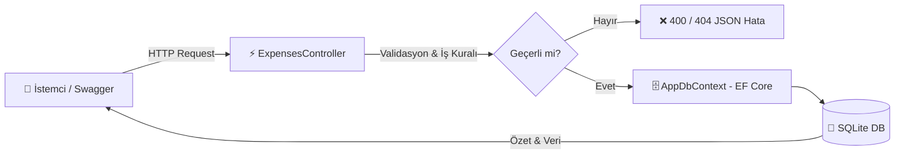

<div align="center">

# ⚡ SeferKasaApi

### _Sefer, Masraf ve Kasa Yönetimi için Akıllı & Temiz Backend API_

<p align="center">
  
  
  
  
  
</p>

**Defter, karmaşık tablolar ve kaybolan fişler bitti.**  
_SeferKasaApi; nakliye, lojistik ve küçük işletmelerin sefer gelirlerini, masraf kalemlerini ve anlık kasa özetlerini kuruş hassasiyetinde yöneten modern bir RESTful Web API'dir._

[🚀 Hızlı Kurulum](#-hızlı-kurulum) • [🔌 API Uçları](#-api-uçları) • [🧠 Sistem Akışı](#-sistem-akışı) • [🗺️ Yol Haritası](#️-yol-haritası)

</div>

---

## 🔥 Neden SeferKasaApi?

Klasik "ekle-sil-listele" projelerinin ötesinde, **gerçek ticari kurallar** düşünülerek tasarlandı:

| Özellik                              | Ne Sağlar?                                                                                        |
| :----------------------------------- | :------------------------------------------------------------------------------------------------ |
| 🔗 **Esnek Sefer–Masraf Bağlantısı** | Masrafları doğrudan bir sefere (`TripId`) bağlar veya genel işletme gideri (`null`) olarak işler. |
| 💰 **Kuruş Hassasiyeti (`18,2`)**    | Tüm finansal alanlar `decimal` ve `HasPrecision(18, 2)` ile saklanır; yuvarlama hatası oluşmaz.   |
| 📊 **Tek İstekle Finansal Özet**     | Toplam gideri, işlem adedini ve kategori bazlı harcama kırılımını anında hesaplar.                |
| 🛡️ **Katı İş Kuralları**             | Sıfır/negatif tutarları ve geçersiz sefer ID'lerini daha veritabanına ulaşmadan reddeder.         |
| ⚡ **Anında Test Edilebilir**        | Dahili **Swagger / OpenAPI** arayüzü ile ek araç kurmadan tarayıcıdan canlı test imkânı.          |

---

## 🧠 Sistem Akışı



---

## 🔌 API Uçları

| Metot  | Endpoint                | Görevi                                                    |      Durum Kodu       |
| :----: | :---------------------- | :-------------------------------------------------------- | :-------------------: |
| `POST` | `/api/expenses`         | Yeni masraf kaydı oluşturur (seferli veya genel).         | `201` / `400` / `404` |
| `GET`  | `/api/expenses/{id}`    | ID'ye göre tek bir masraf kaydını getirir.                |     `200` / `404`     |
| `GET`  | `/api/expenses/summary` | Toplam harcama, kayıt adedi ve kategori dağılımını döner. |         `200`         |

<details>
<summary><b>⚡ Canlı JSON Örneklerini Aç / Kapat</b></summary>

#### 📥 İstek — `POST /api/expenses`

```json
{
  "tripId": null,
  "category": "Fuel",
  "amount": 1850.75,
  "expenseDate": "2026-11-21T18:30:00Z",
  "note": "Ankara - İstanbul güzergahı yakıt alımı"
}
```

#### 📤 Yanıt — `GET /api/expenses/summary`

```json
{
  "totalExpense": 1850.75,
  "expenseCount": 1,
  "byCategory": {
    "Fuel": 1850.75
  }
}
```

</details>

---

## 🗂️ Mimari Yapı

```text
SeferKasaApi/
├── 📂 Controllers/      # HTTP isteklerini yöneten API uçları
├── 📂 Data/             # AppDbContext, hassasiyet ve ilişki ayarları
├── 📂 DTOs/             # Temiz istek & yanıt veri modelleri
├── 📂 Entities/         # Domain varlıkları (Trip, Expense)
├── 📂 Migrations/       # EF Core veritabanı şema geçmişi
├── 📄 Program.cs        # DI kayıtları ve middleware hattı
└── 📄 appsettings.json  # Bağlantı dizesi ve uygulama ayarları
```

---

## 🚀 Hızlı Kurulum

Projeyi kendi bilgisayarında **30 saniyede** ayağa kaldır:

```bash
# 1. Repoyu klonla
git clone [https://github.com/Abuluc/SeferKasaApi.git](https://github.com/Abuluc/SeferKasaApi.git)
cd SeferKasaApi

# 2. Paketleri yükle ve veritabanını oluştur
dotnet restore
dotnet ef database update

# 3. API'yi başlat
dotnet run
```

> 💡 **İpucu:** Uygulama çalıştıktan sonra tarayıcıda `/swagger` adresine giderek tüm uçları görsel arayüzden anında test edebilirsin.

---

## 🗺️ Yol Haritası

- [x] `Trip` ve `Expense` veri modelleri + EF Core SQLite kurulumu
- [x] Masraf ekleme, validasyon kontrolleri ve kategori bazlı özet ucu
- [ ] **Sefer Yönetimi (`Trips`):** Tam CRUD ve durum akışı (`Planned` → `InProgress` → `Completed`)
- [ ] **Tahsilat Takibi (`Payments`):** Kısmi ödemeler, kalan alacak ve net kâr/zarar hesaplama
- [ ] **Temiz Mimari Güçlendirme:** `Service` katmanı ayrımı & Global Exception Handling (`ProblemDetails`)
- [ ] **Raporlama:** Tarih aralığı filtreleme, sayfalama ve CSV / Excel dışa aktarma

---

<div align="center">

**Ahmet Yusuf Buluç** tarafından geliştirilmektedir 🚀

[](https://github.com/Abuluc)

_Projeyi faydalı bulduysan ⭐ vermeyi unutma!_

</div>
