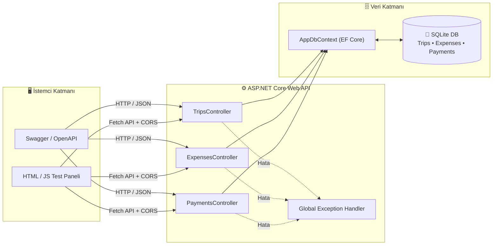

<div align="center">

# ⚡ SeferKasaApi `v1.0`

### _Sefer, Masraf, Tahsilat ve Kasa Yönetimi için Akıllı & Temiz Backend API_

<p align="center">
  
  
  
  
  
</p>

**Dağınık defterler, eksik tahsilatlar ve kaybolan fişler devri kapandı.**  
_SeferKasaApi; nakliye, lojistik ve küçük işletmelerin sefer operasyonlarını, gider kalemlerini, kısmi tahsilatlarını ve anlık kâr/zarar – alacak özetlerini kuruş hassasiyetinde yöneten RESTful Web API'dir._

[🚀 Hızlı Kurulum](#-hızlı-kurulum) • [🔌 API Uçları](#-api-uçları) • [🧠 Sistem Mimarisi](#-sistem-mimarisi) • [🧪 Test Paneli](#-canlı-test-paneli) • [🗺️ Yol Haritası](#️-yol-haritası)

</div>

---

## 🔥 Neden SeferKasaApi?

Klasik CRUD örneklerinin ötesine geçerek **gerçek ticari kurallar ve finansal tutarlılık** üzerine kurgulandı:

| Yetenek                               | Ne Sağlar?                                                                                                                      |
| :------------------------------------ | :------------------------------------------------------------------------------------------------------------------------------ |
| 🚚 **Sefer Yaşam Döngüsü**            | Sefer oluşturma, listeleme, detay görüntüleme ve durum yönetimi (`Planned` → `InProgress` → `Completed` / `Cancelled`).         |
| 💳 **Kısmi Tahsilat & Alacak Takibi** | Ödemeleri ayrı kayıt olarak tutar, tahsil edilen tutarı otomatik günceller ve **kalan alacağın aşılmasını engeller**.           |
| 🧾 **Esnek Masraf Yönetimi**          | Masrafları belirli bir sefere (`TripId`) bağlar veya genel işletme gideri (`null`) olarak kaydeder.                             |
| 📊 **Anlık Kâr / Zarar & Özet**       | Sefer bazında tahsilat, kalan alacak, toplam gider ve net kâr/zarar hesaplamasını tek uçta sunar.                               |
| 💰 **Kuruş Hassasiyeti (`18,2`)**     | Tüm parasal alanlar `decimal` ve `HasPrecision(18, 2)` ile tanımlanmıştır; yuvarlama hatası oluşmaz.                            |
| 🛡️ **Merkezi Hata & Validasyon**      | Geçersiz tutar/durum/ID isteklerini standart HTTP durum kodlarıyla yakalar, beklenmeyen hataları güvenli JSON yanıtına çevirir. |

---

## 🧠 Sistem Mimarisi



---

## 🔌 API Uçları

### 🚚 Seferler (`/api/trips`)

|  Metot  | Endpoint                  | Görevi                                                                        |      Durum Kodu       |
| :-----: | :------------------------ | :---------------------------------------------------------------------------- | :-------------------: |
| `POST`  | `/api/trips`              | Yeni sefer kaydı oluşturur (`Planned` olarak başlar).                         |     `201` / `400`     |
|  `GET`  | `/api/trips`              | Tüm seferleri listeler.                                                       |         `200`         |
|  `GET`  | `/api/trips/{id}`         | ID'ye göre tek sefer detayını getirir.                                        |     `200` / `404`     |
|  `GET`  | `/api/trips/{id}/summary` | Seferin tahsilat, kalan alacak, masraf ve net kâr/zarar özetini döner.        |     `200` / `404`     |
| `PATCH` | `/api/trips/{id}/status`  | Sefer durumunu günceller (`Planned`, `InProgress`, `Completed`, `Cancelled`). | `200` / `400` / `404` |

### 💳 Tahsilatlar (`/api/payments`)

| Metot  | Endpoint                      | Görevi                                                                            |      Durum Kodu       |
| :----: | :---------------------------- | :-------------------------------------------------------------------------------- | :-------------------: |
| `POST` | `/api/payments`               | Sefere tahsilat ekler, kalan alacağı kontrol eder ve `CollectedAmount` günceller. | `201` / `400` / `404` |
| `GET`  | `/api/payments/trip/{tripId}` | Belirli bir sefere ait tüm ödeme hareketlerini listeler.                          |     `200` / `404`     |

### 🧾 Masraflar (`/api/expenses`)

| Metot  | Endpoint                | Görevi                                                         |      Durum Kodu       |
| :----: | :---------------------- | :------------------------------------------------------------- | :-------------------: |
| `POST` | `/api/expenses`         | Seferli veya genel işletme masrafı oluşturur.                  | `201` / `400` / `404` |
| `GET`  | `/api/expenses/{id}`    | Belirtilen ID'ye ait masraf kaydını getirir.                   |     `200` / `404`     |
| `GET`  | `/api/expenses/summary` | Toplam harcama, işlem sayısı ve kategori bazlı dağılımı döner. |         `200`         |

<details>
<summary><b>⚡ Örnek İstek ve Yanıtları İncele (Tahsilat & Sefer Özeti)</b></summary>

#### 📥 Tahsilat Ekle — `POST /api/payments`

```json
{
  "tripId": 1,
  "amount": 5000.0,
  "paymentMethod": "BankTransfer",
  "paidDate": "2026-11-22T00:00:00Z",
  "note": "İlk taksit havalesi"
}
```

#### 📤 Sefer Finansal Özeti — `GET /api/trips/1/summary`

```json
{
  "id": 1,
  "title": "Ankara - İstanbul Seferi",
  "status": "InProgress",
  "agreedAmount": 15000.0,
  "collectedAmount": 5000.0,
  "remainingReceivable": 10000.0,
  "totalExpenses": 2250.0,
  "netProfit": 2750.0
}
```

</details>

---

## 🗂️ Klasör Yapısı

```text
SeferKasaApi/
├── 📂 Controllers/      # TripsController, ExpensesController, PaymentsController
├── 📂 Data/             # AppDbContext, hassasiyet (18,2) ve ilişki kuralları
├── 📂 DTOs/             # İstek ve yanıt veri transfer nesneleri
├── 📂 Entities/         # Trip, Expense, Payment domain modelleri
├── 📂 Migrations/       # EF Core veritabanı migration geçmişi
├── 📂 wwwroot/          # Düz HTML/JS test arayüzü (opsiyonel statik sunum)
├── 📄 Program.cs        # DI kayıtları, CORS, JSON ayarı ve global hata yakalama
└── 📄 appsettings.json  # Bağlantı dizesi ve uygulama ayarları
```

---

## 🚀 Hızlı Kurulum

```bash
# 1. Repoyu klonla
git clone [https://github.com/Abuluc/SeferKasaApi.git](https://github.com/Abuluc/SeferKasaApi.git)
cd SeferKasaApi

# 2. Paketleri yükle ve veritabanını oluştur
dotnet restore
dotnet ef database update

# 3. API'yi ayağa kaldır
dotnet run
```

- **Swagger UI:** Uygulama çalıştıktan sonra `/swagger` adresinden tüm uçları canlı test edebilirsin.

---

## 🧪 Canlı Test Paneli

Proje içinde yer alan düz **HTML + CSS + Vanilla JS** test arayüzü (`index.html`) sayesinde Postman veya Swagger açmadan:

1. API adresini girip **sefer oluşturabilir**,
2. Sefer ID'sine göre **masraf ve tahsilat ekleyebilir**,
3. Tablodan tek tıkla **sefer finansal özetini** ve **genel masraf özetini** görüntüleyebilirsin.

---

## 🗺️ Yol Haritası

- [x] `Trip`, `Expense` ve `Payment` veri modelleri + EF Core SQLite migrations
- [x] Masraf ekleme, validasyon kontrolleri ve kategori bazlı özet ucu
- [x] Sefer oluşturma, listeleme, durum güncelleme (`PATCH /status`) ve finansal özet ucu
- [x] Kısmi tahsilat takibi, fazla ödeme engeli ve merkezi hata yakalama (`v1.0`)
- [x] Düz HTML/JS test arayüzü ile uçtan uca API doğrulama
- [ ] **v1.1 Fikirleri:** Tarih aralığı (`from`/`to`) filtreleme, sayfalama, `Service` katmanı ayrımı ve CSV/Excel dışa aktarma

---

<div align="center">

**Ahmet Yusuf Buluç** tarafından geliştirildi 🚀

[](https://github.com/Abuluc)

_Emeğe saygı için repoya ⭐ bırakmayı unutma!_

</div>
